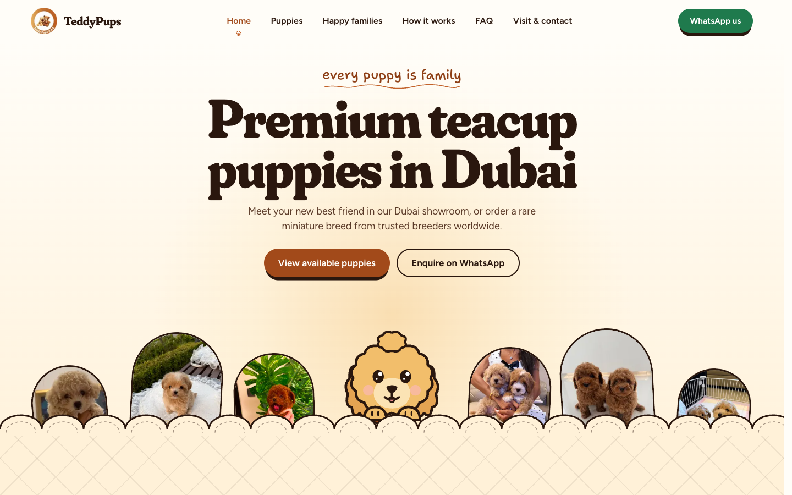

# TeddyPups clone

A rebuild of [puppy.instabizweb.com](https://puppy.instabizweb.com/) made for the Insta Biz Web technical assignment.

- Live site: https://teddypups-insta-biz.vercel.app
- Repository: https://github.com/SrijanShi/INSTA_BIZ
- How it was built (process log, AI tools and exact prompts): [docs/PROCESS.md](docs/PROCESS.md)
- Video walkthrough outline: [docs/LOOM_SCRIPT.md](docs/LOOM_SCRIPT.md)



## What's in it

Every page of the reference site, with the same content, layout, responsive behaviour and interactions:

| Route | What happens there |
| --- | --- |
| `/` | Eight scenes whose sky goes from morning to night as you scroll. Puppies peek over a quilt and swap places, a pinned hallway of doors slides past on desktop, chat messages arrive step by step, and a polaroid wall opens into a photo viewer. Teddy, the mascot, walks down the page with you. |
| `/puppies` | "Teddy's sketchbook" of the 15 available puppies. Filters for where, breed and boy/girl live in the URL, so a filtered view can be shared or reloaded. |
| `/puppies/[slug]` | A storybook page for each of the 42 puppies (available and gone home): photo/video gallery with a full-screen viewer, facts, the way home, and an enquiry form. |
| `/happy-families` | 64 family photos as taped polaroids, with a swipeable viewer. |
| `/gone-home` | A ticket stub for every puppy that has found a family. |
| `/how-it-works` | A switch between visiting the Dubai showroom and ordering an import, the puppy promise, and a plane that flies the Korea to Dubai route as you scroll. |
| `/faq` | Questions pinned to a cork board. They unfold on click, and the search box filters and highlights them. |
| `/contact` | A "Dear TeddyPups," letter with blanks to fill in. Sending it seals an envelope and posts it into a post box. |
| anything else | A "LOST" poster with tear-off links. |

Across the site: a curtain with a running dog covers page changes, the header hides while you scroll down, phones get a full-screen menu and a sticky WhatsApp/Call bar, a trail of paw prints follows the mouse, and wheel scrolling is smoothed with Lenis. Everything respects `prefers-reduced-motion`.

## Stack

Matched to what the reference site ships (found by inspecting its bundles, see the process log):

- Next.js 16 (App Router, React 19, Turbopack, Cache Components). All 7 pages and 42 puppy pages are prerendered at build time.
- TypeScript
- Tailwind CSS v4, with the brand palette and type scale as theme tokens
- `next/font` for Fraunces, Figtree and Shantell Sans
- `motion` for the puppy grid, gallery and viewer animations
- `lenis` for smooth wheel scrolling
- A Server Action for both enquiry forms
- Playwright for end-to-end tests
- Vercel for hosting

## Running it

Node 20 or newer.

```bash
npm install
npm run dev        # http://localhost:3000
npm run build && npm start
```

Enquiries are validated on the server and logged to the console. To have them emailed instead, set these in `.env.local` (or in Vercel):

```bash
RESEND_API_KEY=...            # https://resend.com
ENQUIRY_TO=you@example.com    # where enquiries go
ENQUIRY_FROM="TeddyPups <hello@your-domain.com>"   # optional
```

The clone never emails the real business by default.

## Scripts

| Command | |
| --- | --- |
| `npm run dev` / `build` / `start` | Next.js |
| `npm run lint`, `npm run typecheck` | ESLint, `tsc --noEmit` |
| `npm run test:e2e` | Builds, starts the app and runs the Playwright suite (desktop and mobile). Set `BASE_URL` to test a deployment instead. |
| `npm run content:extract <dir>` | Rebuilds `src/content/*.json` from saved copies of the reference pages |
| `npm run media:fetch` | Downloads every photo and video the content refers to into `public/media` |
| `npm run media:optimize` | Shrinks oversized JPEGs in place |
| `npm run styles:port <css> <dir>` | Splits the reference stylesheet into per-feature CSS files |

## Project layout

```
src/
  app/                  routes, layout, not-found, error, sitemap, robots, icons
    actions/enquiry.ts  the sendEnquiry server action
  components/
    shell/              header, mobile menu, footer, route curtain, smooth scroll, paw trail
    mascot/             Teddy: geometry and poses (rig.ts), SVG, animation driver, tricks
    home/               the eight home scenes and the walking Teddy (PupJourney)
    puppies/ puppy/     sketchbook cards and filters; storybook gallery
    families/ faq/ how/ contact/ forms/
    MediaImage, PhotoViewer, Polaroid, Scene, Stamps, Flight, RevealScope
  content/              puppies, breeds, families, faqs, sections, journeys (JSON)
  lib/                  typed content loaders, site details, motion helpers
  styles/               theme tokens, base, and one CSS file per feature
scripts/                content extraction, media download/optimisation, style port
tests/e2e/              Playwright specs
docs/                   process log and video outline
```

## Testing

`npm run test:e2e` runs 28 scenarios on a desktop (1440×900) and a mobile (Pixel 7) browser against the production build: every route and the 404, the sitemap, WhatsApp links, puppy filters and the empty state, the gallery and prev/next links, the mobile menu, FAQ search, the how-it-works tabs, the photo viewer, and both forms (server validation, focus handling, success states). GitHub Actions runs lint, build, typecheck and the suite on every push.

## Notes

The content, photos and brand belong to the reference site. They are reproduced here only for this assessment.
